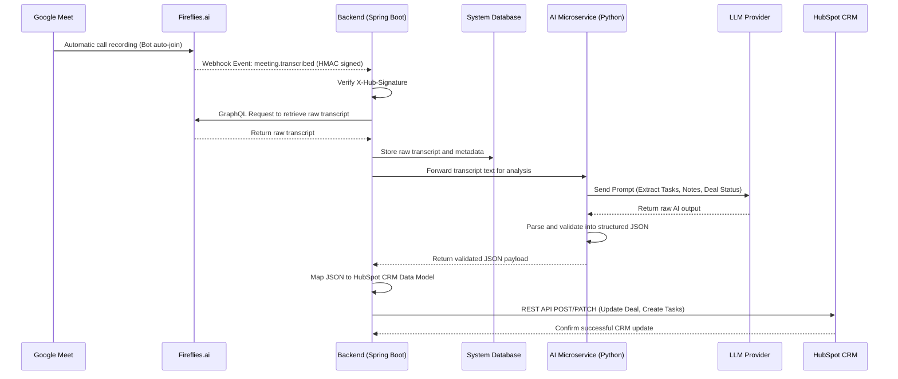

# System Architecture & Design - AutoCRM (Revelis)

## Project Context
AutoCRM is a custom middleware system designed to eliminate manual data entry in HubSpot CRM for the company Revelis by automating the workflow between sales calls and the CRM. The system leverages Fireflies.ai to capture meeting calls transcriptions and an AI agent (Large Language Model) to extract actionable business insights, such as deal stage updates, meeting notes, and task assignments, which are then automatically synchronized to HubSpot.

## Architecture & Design

The system we have thought to implement, follows an event-driven architecture designed to avoid unnecessary polling and ensure near real-time updates. The responsibilities rely both on a core backend and an AI microservice, detailed as follows:

* **Spring Boot (Java) Backend:** Acts as the public webhook endpoint to receive events from [Fireflies.ai](https://fireflies.ai/) (`meeting.transcribed`), verifies security signatures (HMAC), queries the GraphQL API for the raw transcript, saves the data to the local database, and orchestrates the final REST API calls to Hubspot.

* **Python Microservice:** Receives the raw transcript from the Java backend, formulates the prompt, interacts with the LLM to extract structured data (JSON), and validates the mapping for the CRM data model.

## Technology Stack

* **Backend Framework:** Spring Boot (Java)
* **AI/NLP Service:** Python (LangChain)
* **Integrations:** Fireflies.ai (GraphQL & Webhooks), HubSpot CRM (REST API v3)
* **CI/CD:** GitHub Actions

## Current WIP State (Sprint 1)
The team is currently focused on:
* Investigating [Fireflies.ai](https://fireflies.ai/) and HubSpot API rate limits and authentication.
* Setting up local webhook testing endpoints.

## Local Setup Instructions
*(Instructions on how to configure the local environment, build the project, and required .env variables will be documented here as the foundational code is pushed).*

