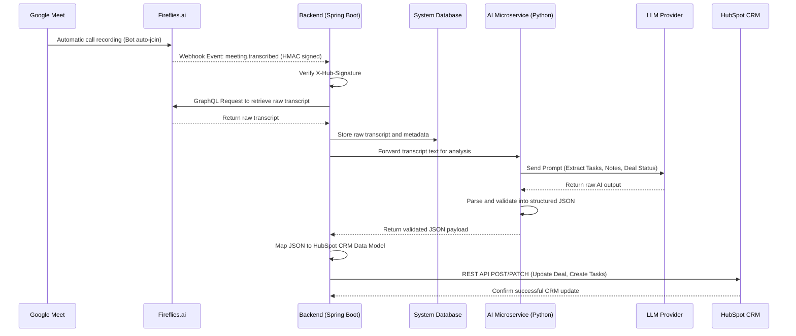

# AutoCRM - Architecture & System Design 

## Project Context
AutoCRM is a custom middleware system designed to eliminate manual data entry in [HubSpot](https://www.hubspot.com/) CRM for the company Revelis. It is meant to automate the workflow between sales calls and the CRM by leveraging [Fireflies.ai](https://fireflies.ai/) to capture meeting calls transcriptions, and an AI agent (Large Language Model) to extract actionable business insights (such as deal stage updates, meeting notes, and task assignments), which are then automatically synchronized to [HubSpot](https://www.hubspot.com/).

## Architectural design 

The system we have thought to implement, follows an event-driven architecture designed to avoid unnecessary API polling and ensure near real-time updates. The responsibilities rely both on a core backend and an AI microservice, detailed as follows:

* **Spring Boot (Java) Backend:** Acts as the public webhook endpoint to receive notifications from [Fireflies.ai](https://fireflies.ai/) (`meeting.transcribed`), verifies the HMAC security signature, queries the GraphQL API to retrieve the raw transcript, securely stores the data in the system database (for backup and audit purposes), and arranges the final REST API calls to populate the [HubSpot](https://www.hubspot.com/) Data Model.

* **Python Microservice:** Dedicated exclusively to AI and Natural Language Processing (NLP). It receives the raw transcript from the Java backend, formulates the prompt, interacts with the LLM (e.g., OpenAI/Anthropic) to extract structured data, and returns a strictly validated JSON payload mapped to the CRM entities (Contacts, Deals, Notes, Tasks).

## System Flow (Sequence Diagram)

