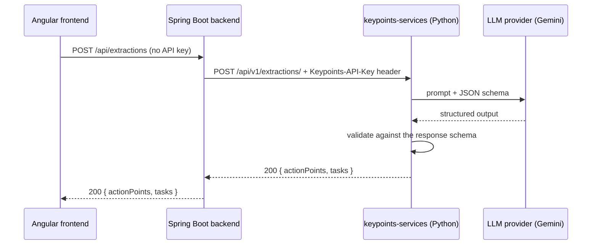

# API Contract

This document defines the JSON API endpoints, payloads and status codes agreed upon between the frontend, the
backend and the Python microservices.

| Part | Endpoints | Between |
|---|---|---|
| [Sprint 2: Audio Upload & Review](#sprint-2-audio-upload--review) | `/api/transcriptions/**` | Angular → Spring Boot |
| [Extraction of action points and tasks](#extraction-of-action-points-and-tasks) | `POST /api/extractions` | Angular → Spring Boot |
| | `POST /api/v1/extractions` | Spring Boot → keypoints-services (Python, internal) |
| [HubSpot Deals](#hubspot-deals) | `GET /api/hubspot/deals` | Angular → Spring Boot |

---

# Sprint 2: Audio Upload & Review

The endpoints, payloads and status codes agreed upon between the frontend and backend for the Sprint 2 transcription flow.

## 1. Upload Audio
Receives the audio file and starts the background transcription process.

* **Endpoint:** `POST /api/transcriptions/upload`
* **Content-Type:** `multipart/form-data`
* **Payload:**
  * `file`: The audio file to be transcribed.
* **Success Response (202 Accepted):**
  ```json
  {
    "jobId": "string (unique identifier for the background job)",
    "status": "processing"
  }
  ```
* **Error Response (400 Bad Request):**
  ```json
  {
    "error": "Invalid file format or file size exceeded."
  }
  ```  

## 2. Check Transcription Status
Polled by the frontend to check if the transcription job is complete.

* **Endpoint:** `GET /api/transcriptions/{jobId}`
* **Success Response - Still Processing (200 OK):**
  ```json
  {
    "jobId": "string",
    "status": "processing",
    "transcript": null
  }
  ```
* **Success Response - Done (200 OK):**
  ```json
  {
    "jobId": "string",
    "status": "done",
    "transcript": "string (the raw transcription text generated by the engine)"
  }
  ```
* **Error Response (404 Not Found):**
  ```json
  {
    "error": "Job ID not found."
  }
  ```

## 3. Approve & Send to HubSpot
Sends the user-edited transcript and target deal code to be pushed to the CRM.

* **Endpoint:** `POST /api/transcriptions/{jobId}/approve`
* **Content-Type:** `application/json`
* **Payload:**
  ```json
  {
    "dealCode": "string (the HubSpot deal identifier)",
    "text": "string (the reviewed and edited transcript text)"
  }
  ```
* **Success Response (200 OK):**
  ```json
  {
    "noteId": "string (the created HubSpot Note ID)",
    "status": "success"
  }
  ```
* **Error Response (400 Bad Request):**
  ```json
  {
    "error": "Deal code and text cannot be empty."
  }
  ```

> **`dealCode` resolution (SCRUM-98):** if the value is all digits it is treated
> as a numeric HubSpot Deal ID and matched against `hs_object_id`; otherwise it
> is matched by Deal Name (`dealname`). Only one filter is used per request to
> avoid duplicate matches.

---

# Extraction of action points and tasks

The LLM reads a transcript and returns the **action points** (what was agreed in the call) and the **tasks** (concrete
to-dos with an owner and a due date) that the backend then pushes to HubSpot. Two endpoints are involved:



- **The frontend only calls Spring Boot** (`POST /api/extractions`). It never calls keypoints-services and never holds
  the internal API key, which lives only in the backend environment.
- **keypoints-services is internal**: in a deployment it is reachable only from the backend (not exposed to the
  internet), and every request must carry the API key.
- The call is **synchronous**: with Gemini 3.5 Flash-Lite (see `docs/llm-selection.md`) an extraction takes seconds.

## Shared conventions

These rules apply to both endpoints.

- **Content type:** `application/json; charset=utf-8` for requests and responses.
- **Field names:** `camelCase` in every JSON body.
- **Dates:** `dueDate` and `meetingDate` are calendar dates in ISO 8601 format, `YYYY-MM-DD` (no time, no time zone).
- **Missing values are `null`, never omitted and never invented.** If the transcript does not say who owns a task or
  when it is due, `assignee` / `dueDate` is `null`. The LLM must not guess.
- **Empty result is a success:** a transcript with nothing actionable returns `200 OK` with empty arrays, not `404`
  or `204`.
- **Order:** items appear in the order they are discussed in the transcript.
- **Error body:** every 4xx/5xx response has the same shape. `error` is a human-readable message (safe to show, never
  containing stack traces, keys or transcript text); `code` is a stable machine-readable value from the tables below.
  ```json
  {
    "error": "The transcript cannot be empty.",
    "code": "invalid_request"
  }
  ```
- **Forward compatibility:** new optional fields may be added to responses without a version change. Clients must
  ignore unknown fields (Jackson: `@JsonIgnoreProperties(ignoreUnknown = true)`; TypeScript: just don't read them).
  Removing or renaming a field, or changing its type, requires `/api/v2/...`.

### Request fields (same for both endpoints)

| Field | Type | Required | Rules |
|---|---|---|---|
| `transcript` | string | **yes** | Plain text of the call, as approved by the user. Not blank after trimming; at most **200,000 characters** (≈ 50k tokens, about two hours of conversation). |
| `language` | string \| null | no | ISO 639-1 code of the transcript language, lowercase: `"it"` or `"en"`. Default `"it"`. Titles and descriptions are written in this language. |
| `meetingTitle` | string \| null | no | Title of the meeting, at most 255 characters. Gives the LLM context (e.g. the customer name). |
| `meetingDate` | string \| null | no | Date of the call, `YYYY-MM-DD`. Used to turn relative dates ("venerdì prossimo", "by end of month") into a `dueDate`. If missing, relative dates give `dueDate: null`. |

> The 200,000 character limit applies to extraction only. `POST /api/v1/transcripts/` (persistence, SCRUM-17) keeps its
> own 100,000 character limit.

### Response fields (same for both endpoints)

| Field | Type | Always present | Description |
|---|---|---|---|
| `actionPoints` | array of ActionPoint | yes (may be empty) | Key outcomes of the call: decisions, agreements, open issues. They go into the HubSpot **Note** attached to the deal. |
| `tasks` | array of Task | yes (may be empty) | Concrete follow-up actions that someone must do. Each one becomes a HubSpot **Task**. |
| `language` | string | yes | Language used for the output (`"it"` / `"en"`). |
| `model` | string | yes | LLM that produced the result, e.g. `"gemini-3.5-flash-lite"` (for audit and for comparing models). |

**ActionPoint**

| Field | Type | Nullable | Rules |
|---|---|---|---|
| `title` | string | no | Short summary, at most 120 characters. |
| `description` | string | yes | One or two sentences of detail, at most 2,000 characters. |

**Task**

| Field | Type | Nullable | Rules | HubSpot Task property |
|---|---|---|---|---|
| `title` | string | no | Imperative sentence, at most 255 characters ("Inviare il preventivo aggiornato"). | `hs_task_subject` |
| `description` | string | yes | Context needed to do the task, at most 2,000 characters. | `hs_task_body` |
| `assignee` | string | yes | Name of the person responsible **as said in the call** (e.g. `"Marco Rossi"`). It is not a HubSpot owner id: the backend resolves it, or leaves the task unassigned. | `hubspot_owner_id` (after resolution) |
| `dueDate` | string (`YYYY-MM-DD`) | yes | Only if stated or derivable from `meetingDate`. | `hs_timestamp` |
| `priority` | `"LOW"` \| `"MEDIUM"` \| `"HIGH"` | yes | Only if the call makes the urgency clear. | `hs_task_priority` |

The difference in one line: an **action point** is something to *know* ("the customer accepted the 10% discount"),
a **task** is something to *do* ("send the revised offer by Friday"). The same fact may produce both.

### Example

Request:

```json
{
  "transcript": "Marco: Allora confermiamo lo sconto del 10% sul rinnovo. Giulia: Perfetto, entro venerdì ti mando il contratto aggiornato. Marco: Ottimo, e ci serve anche la demo del modulo report per il team vendite...",
  "language": "it",
  "meetingTitle": "Rinnovo licenze - ACME S.p.A.",
  "meetingDate": "2026-11-23"
}
```

Response `200 OK`:

```json
{
  "actionPoints": [
    {
      "title": "Confermato lo sconto del 10% sul rinnovo",
      "description": "ACME accetta il rinnovo annuale con uno sconto del 10% sul listino."
    },
    {
      "title": "Interesse per il modulo report",
      "description": "Il team vendite di ACME vuole valutare il modulo report prima di estendere il contratto."
    }
  ],
  "tasks": [
    {
      "title": "Inviare il contratto di rinnovo aggiornato",
      "description": "Contratto con lo sconto del 10% concordato in call.",
      "assignee": "Giulia",
      "dueDate": "2026-11-27",
      "priority": null
    },
    {
      "title": "Organizzare una demo del modulo report",
      "description": "Demo per il team vendite di ACME.",
      "assignee": null,
      "dueDate": null,
      "priority": null
    }
  ],
  "language": "it",
  "model": "gemini-3.5-flash-lite"
}
```

## 4. Extract (internal): keypoints-services

Called **only by the Spring Boot backend** (`KeyPointsService`). Implemented by keypoints-services (Django REST).

* **Endpoint:** `POST /api/v1/extractions/`
  (with the trailing slash, like `/api/v1/transcripts/`; local base URL `http://127.0.0.1:8701`)
* **Authentication:** header **`Keypoints-API-Key: <key>`**, required on every request. Same pattern as
  `Transcription-API-Key` on transcription-service. The service compares it in constant time
  (`secrets.compare_digest`) with its own `KEYPOINTS_API_KEY`.
* **Payload / success response:** see [Request fields](#request-fields-same-for-both-endpoints) and
  [Response fields](#response-fields-same-for-both-endpoints). The response is validated against the schema before
  it is returned: the service never returns raw LLM output.
* **Persistence:** extraction does not save anything. Storing the transcript and its key points stays with
  `POST /api/v1/transcripts/`.

```http
POST /api/v1/extractions/ HTTP/1.1
Host: 127.0.0.1:8701
Content-Type: application/json
Keypoints-API-Key: <value of KEYPOINTS_API_KEY>

{ "transcript": "...", "language": "it", "meetingTitle": "...", "meetingDate": "2026-11-23" }
```

**Status codes**

| Status | `code` | When |
|---|---|---|
| `200 OK` | – | Extraction succeeded (arrays may be empty). |
| `400 Bad Request` | `invalid_request` | Body is not valid JSON or not an object, `transcript` missing/blank/too long, `language` not `it`/`en`, `meetingTitle` too long, `meetingDate` not `YYYY-MM-DD`. The `error` message names the field. Also used instead of DRF's default `415` for a wrong `Content-Type`. |
| `401 Unauthorized` | `unauthorized` | `Keypoints-API-Key` header missing or wrong. Same message in both cases (`"Invalid or missing API key."`). Checked before the body is validated. |
| `429 Too Many Requests` | `rate_limited` | The LLM provider's quota is exhausted (Gemini free tier: 10 requests/min, 500/day) after the retries below. The response carries a **`Retry-After`** header in seconds when known. |
| `502 Bad Gateway` | `llm_unavailable` | The LLM provider is unreachable, times out (60 s per attempt) or answers 5xx. |
| `502 Bad Gateway` | `llm_invalid_output` | The LLM answered, but its output does not match the schema even after one retry. |

Retry policy inside keypoints-services (from `docs/llm-selection.md`): an LLM `429` is retried at most 3 times with
backoff, then the fallback model is tried; only then does the service answer `429`. The caller must not add its own
retry loop on top of `429` or `502`.

Unexpected bugs answer `500 Internal Server Error` with `code: "internal_error"`; this is not part of the contract
and the backend treats it like a `502`.

## 5. Extract (public): Spring Boot

Called by the Angular frontend. The backend validates the request, forwards it to keypoints-services with the API key
and returns the result. The frontend uses the existing base URL (`environment.apiBaseUrl`, e.g.
`http://localhost:8080/api`).

* **Endpoint:** `POST /api/extractions`
* **Authentication:** none from the frontend in this sprint (same as the other `/api/**` endpoints). The frontend
  never sends `Keypoints-API-Key`.
* **Payload / success response:** identical to the internal endpoint (see
  [Request fields](#request-fields-same-for-both-endpoints) and
  [Response fields](#response-fields-same-for-both-endpoints)). The backend validates the same rules before calling
  keypoints-services, so a bad request is rejected without spending LLM quota. The success body is returned as
  received.
* **Timeout:** the backend waits up to **180 s** for keypoints-services (enough for the retries above); the frontend
  should wait up to **200 s** and show a progress state meanwhile.

**Status codes**

| Status | `code` | When | What the frontend does |
|---|---|---|---|
| `200 OK` | – | Extraction succeeded. | Show action points and tasks for review. Empty arrays: "No action points or tasks found." |
| `400 Bad Request` | `invalid_request` | Validation failed in the backend (or keypoints-services answered `400`). | Show `error`; let the user fix the transcript. |
| `429 Too Many Requests` | `rate_limited` | keypoints-services answered `429`. `Retry-After` is forwarded. | "Too many extractions, try again in N seconds." No automatic retry. |
| `502 Bad Gateway` | `extraction_unavailable` | keypoints-services is unreachable, timed out, answered `401` or `5xx`, or sent a body that does not match the schema. | "The extraction service is not available, try again later." |

How the backend maps the internal answers:

| keypoints-services answer | Spring Boot answer | Notes |
|---|---|---|
| `200` | `200` | Body passed through. |
| `400` | `400` | `error` passed through (it names the field, never contains secrets). |
| `401` | `502` `extraction_unavailable` | A wrong or missing key is a **backend configuration error**: log it at `ERROR`, never forward `401` to the browser. |
| `429` | `429` | `Retry-After` header forwarded. |
| `502`, `500`, timeout, connection refused | `502` `extraction_unavailable` | Details only in the logs (same rule as `KeyPointsUnavailableException`). |

## Configuration

| Where | Name | Value |
|---|---|---|
| Spring Boot `application.properties` | `keypoints.service.url` | already present; default `http://127.0.0.1:8701` |
| Spring Boot `application.properties` | `keypoints.service.apiKey` | `${KEYPOINTS_SERVICE_API_KEY}` |
| keypoints-services `.env` | `KEYPOINTS_API_KEY` | same value as `KEYPOINTS_SERVICE_API_KEY` |
| keypoints-services `.env` | `LLM_BASE_URL`, `LLM_MODEL`, `LLM_API_KEY` | see `docs/llm-selection.md`, Appendix A |

Keys are only ever set as environment variables or in git-ignored `.env` files, never in code, in
`application.properties` values, in commits or in logs. Generate the shared key with e.g.
`python -c "import secrets; print(secrets.token_urlsafe(32))"`.

## Testing against the contract

- **keypoints-services:** tests mock the LLM client; they cover every status code in section 4 and check that the
  response matches the schema. CI never calls a real LLM.
- **Spring Boot:** like `KeyPointsControllerTest` / `RemoteTranscriptionEngineServiceApiKeyTest`, a stub server checks
  that the `Keypoints-API-Key` header is sent and that each internal answer is mapped as in section 5.
- **Angular:** until the backend is ready, mock `POST /api/extractions` with the example response above (and with a
  `429` and a `502`) using `HttpTestingController`.

---

# HubSpot Deals

Endpoints for interacting with HubSpot deals in the meeting ingestion workflow.

## 1. List Deals (SCRUM-101)

Fetches existing deals from HubSpot to populate the deal dropdown selector in the frontend. Responses are cached server-side (60 s TTL) to respect HubSpot API rate limits.

* **Endpoint:** `GET /api/hubspot/deals`
* **Response Content-Type:** `application/json; charset=utf-8`
* **Success Response (200 OK):**
  ```json
  [
    {
      "dealId": "string (the numeric HubSpot Deal ID)",
      "dealName": "string (the name of the deal)",
      "dealStage": "string (internal stage identifier, e.g. 'qualifiedtobuy')"
    }
  ]
  ```
* **Error Response (500 Internal Server Error):**
  Returned if an error occurs while communicating with HubSpot.

